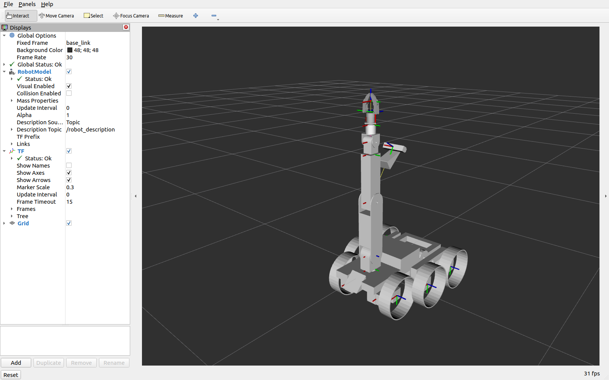

# tzb_description（ROS 2 Humble，现场适配版）

`tzb_description` 机器人描述包。来源是 2026-10-27 的 SolidWorks 整车导出（原包名
`tzb_description2`，已由 ROS 1 catkin 转为 ROS 2 ament），并按本机 lite_motion_planner
的既有约定做了**包内**适配，外部配置（`tzb_planner.yaml`、`tzb_description.srdf`）无需改动。



## 为什么改包名和 link 名

现场 `lite_motion_planner` 的约定是：

| 位置 | 约定值 |
| --- | --- |
| `config/tzb_planner.yaml` → `urdf_path` | `.../tzb_description/urdf/tzb_description.urdf` |
| `tzb_description.srdf` → arm 链 `tip_link` | `J6_link`（小写 l） |
| `tzb_planner.yaml` → `J6_link` 碰撞列表 | `J6_link` |
| URDF 内 `package://` | `package://tzb_description/...` |
| ament 安装前缀 | `install/tzb_description` |

原始导出使用 `tzb_description2` 包名、`J1_Link`…`J6_Link` 大写 link 名，与本机栈不兼容：
arm 组链找不到 `J6_link`、`urdf_path` 指向的文件不存在、`package://` 解析不到。

因此本包在**包内**做了如下对齐，`lite_motion_planner` 一行都不用改：

| 项目 | 原始导出 | 本包 |
| --- | --- | --- |
| 包名 / 工程名 | `tzb_description2` | `tzb_description` |
| URDF 文件 | `urdf/tzb_description2.urdf` | `urdf/tzb_description.urdf`（另保留原始导出 `tzb_description2.urdf` 供对照） |
| link 名 | `J1_Link` … `J6_Link` | `J1_link` … `J6_link` |
| mesh URI | `package://tzb_description2/meshes/...` | `package://tzb_description/meshes/...` |
| `<robot name>` | `tzb_description2` | `tzb_description`（与 SRDF 一致） |

网格文件名保持导出原样（`meshes/J1_Link.STL` 等），只改了 URI 里的包名。

## 目录结构

```
tzb_description/
├── CMakeLists.txt / package.xml
├── config/joint_names_tzb_description2.yaml
├── launch/display.launch.py      # RViz2 显示
├── launch/gazebo.launch.py       # Gazebo Classic（需 gazebo_ros）
├── meshes/*.STL                  # 20 个网格
├── rviz/tzb_description.rviz
├── urdf/tzb_description.urdf     # 生效模型：21 links / 20 joints
├── urdf/tzb_description2.urdf    # 原始导出（未改，仅供参考）
└── docs/rviz_display.png
```

## 编译

```bash
cd ~/tzb_ws
colcon build --packages-select tzb_description --symlink-install
source install/setup.bash
```

注意必须用 `--packages-select tzb_description`：包名是 `tzb_description`，不是目录里原来
`tzb_description2` 那个名字。

## 运行

```bash
ros2 launch tzb_description display.launch.py          # RViz2 + 关节滑块
ros2 launch tzb_description display.launch.py rviz:=false
ros2 launch lite_motion_planner planning_node.launch.py \
    params_file:=$HOME/tzb_ws/src/lite_motion_planner/config/tzb_planner.yaml \
    use_rviz:=false use_robot_state_publisher:=false
```

## 校验结果

* `check_urdf` 通过，根 link `base_link`，21 links / 20 joints；
* SRDF 中引用的全部 link（含底盘、轮系）在本 URDF 中都存在；
* arm 链 `base_link → J6_link` 解析出 6 个关节，与 `tzb.ini/place/observe/sentry_joint_positions` 的 6 维数组匹配；
* `tzb.observe_joint_positions = [0, 0, -2.0, 0, 1.57, 0]` 在限位内。

运行时校验（2026-10-28 21:25，本机 Humble）：

* `planning_node` 正常加载模型：`geometries=20, active_collision_pairs=189`，没有再出现启动崩溃；
* `check_state_collision(group=arm, observe)` → `success=True, in_collision=False`；
* `plan_arm_motion(plan_only=true, goal=observe)` → `success=True`，RRTConnect 0.057 s，轨迹 2 点。

说明：当时底盘串口驱动是 `arm_serial=false`（探索模式，不带臂反馈），所以这次只做了
`plan_only` 的规划校验，没有驱动物理臂；实机动作仍需在启动 `tzb_catch` 后确认。

## 与旧模型的差异（需实机验证）

旧模型是 11 link / 10 joint 的纯臂模型，新模型是 21 link 的整车模型，除了 link 命名还有：

* `J1_joint` 原点由 `0 0.2 0.014` 变为 `0 0 0.014`（差 20 cm，影响 base_link 下的 IK 目标）；
* `base_link` 质量 26.2 kg → 16.9 kg，质心/惯量同步变化；
* `J6_joint` 限位 ±2.88 → ±3.14，其余关节限位四舍五入到两位小数；
* 新增底盘、悬挂、轮系 link（SRDF 里本来就有这些 link 的 disable_collisions 条目）。

新导出的 `<limit>` 只写了位置、没写 `effort` / `velocity`（全为 0）。规划器
`trajectory_generator.cpp` 用 `std::max(1e-3, URDF velocity)` 做时间参数化，速度 0 会被兜底成
0.001 rad/s——1.26 rad 的行程会被算成 **1255 s**，机械臂几乎不动。现已按旧模型实测值恢复
J1–J6 与夹爪的 `effort` / `velocity`，并把位置限位对齐旧值（observe/sentry/place 不再卡在边界）：

| 关节 | effort (Nm) | velocity (rad/s) |
| --- | --- | --- |
| J1 / J2 | 20 | 1.6666 / 1.666 |
| J3 | 12 | 0.6 |
| J4 / J5 / J6 | 3.5 | 2.0 |
| 夹爪 | 0.8 | 2.5 |

修复后实测：`plan_arm_motion(plan_only, goal=observe)` 的轨迹时长由 1255.6 s 变为 3.333 s。

另外 `J5_joint` 上限（1.57）与 `J2_joint` 上限（1.13）正好等于 observe / sentry 预设值，
余量为 0；若实机出现“到不了观测姿态”，优先检查这两个限位是否需要留 0.001 rad 余量。

## 已知问题（沿用导出数据，未改动）

* `right_wheel_f_Link` 质量/惯量为 0；
* 底盘/轮系关节仍为 `effort="0" velocity="0"`（不参与臂规划，暂未改动）；
* 无 `<gazebo>` 插件 / `<transmission>`，Gazebo 中仅静态展示。
